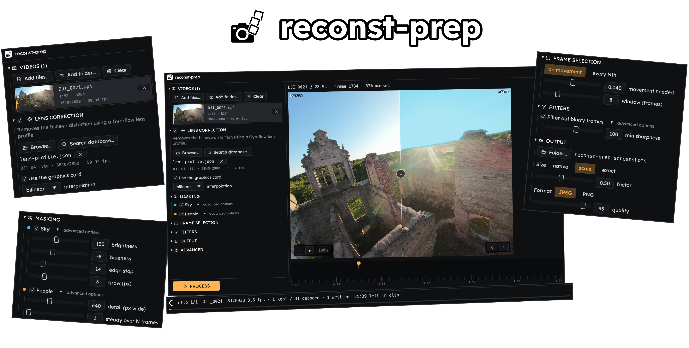
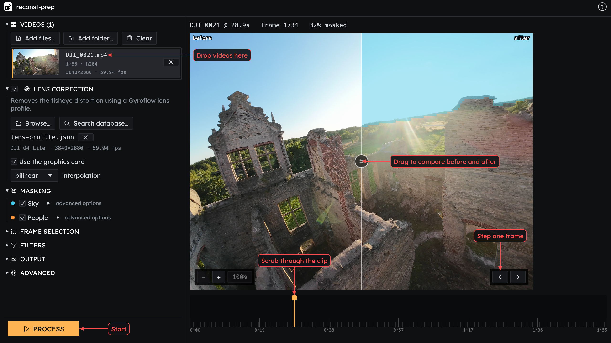
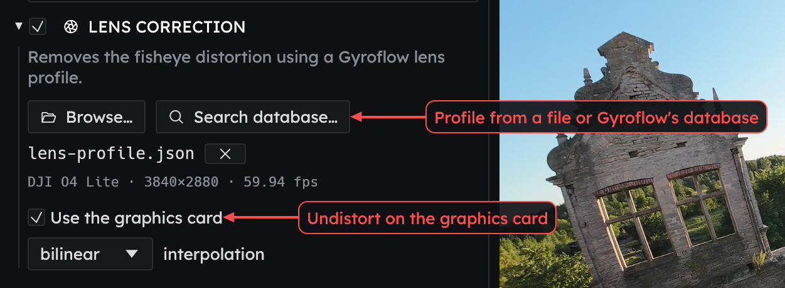
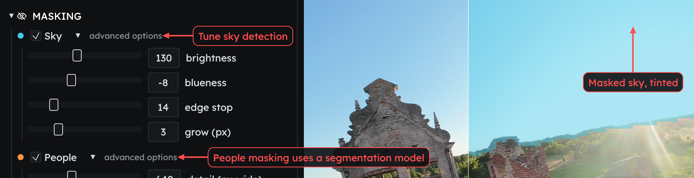
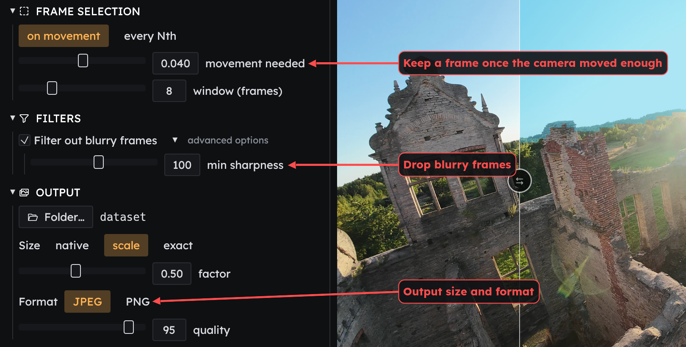
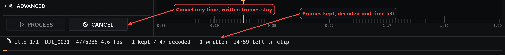

<p align="center">
  
</p>

Easy to use tool for preparing video footage for 3D reconstruction as an image dataset.

Works with drone footage, phone footage and anything else that might need clean up.

- Undistort fisheye lens footage
- Mask out people and sky
- Filter out blurry frames
- Downscale footage, for cases in which too high resolution might take more vram than you have.
- Split video into frames based on movement or every Nth frame.

# Usage

# GUI

Open it from your launcher, or run `reconst-prep gui` (optionally with clips, `--profile` and `--out`).
Drop videos onto the window, pick an output folder and press Process.
The preview on the right shows the frame before and after your settings, drag the divider to compare.



## Lens correction

Lens correction undistorts fisheye footage with a Gyroflow lens profile, either from a file or searched from Gyroflow's database:



## Feature detection

Sky and people masking, with tunable sky detection. People masking needs a segmentation model, which can be downloaded from its advanced options:



## Frame selection algorithms

Frame selection keeps a frame once the camera has moved enough (or every Nth frame), filters drop blurry frames, and output sets the size and image format:



Processing shows progress per clip and how many frames were kept:



# CLI

Running `reconst-prep` without a subcommand processes the given videos (or folders of videos) into one dataset.
Everything is opt-in, without flags it just splits the video into frames. See `reconst-prep --help` for every option.

```bash
# Drone footage: find and download the lens profile, then undistort with it
reconst-prep profiles search dji o4 4k
reconst-prep profiles get "<path from the search>"
reconst-prep DJI_0021.MP4 --profile DJI_O4_lens_profile.json --out dataset/

# Mask the sky and people (people masking needs an ADE20K segmentation model, e.g. SegFormer-B0)
reconst-prep clips/ --out dataset/ --mask-sky --mask-people --seg-model segformer-b0-ade-512.onnx

# Keep every 10th frame instead of selecting by movement, and drop blurry ones
reconst-prep clip.mp4 --out dataset/ --select every-nth --nth 10 --blur-floor 100

# Downscale to half size, or to an exact size, as PNG
reconst-prep clip.mp4 --out dataset/ --size 0.5
reconst-prep clip.mp4 --out dataset/ --size 1920x1080 --format png

# Continue a run that was interrupted
reconst-prep clips/ --out dataset/ --resume
```

# Installation

# Nix/NixOS

Run it straight from the repository:

```bash
nix run github:BatteredBunny/reconst-prep
```

Or add the flake to your inputs and install the package, either directly or through the overlay:

```nix
{
  inputs.reconst-prep.url = "github:BatteredBunny/reconst-prep";

  outputs = { nixpkgs, reconst-prep, ... }: {
    nixosConfigurations.my-machine = nixpkgs.lib.nixosSystem {
      modules = [
        ({ pkgs, ... }: {
          environment.systemPackages = [ reconst-prep.packages.${pkgs.stdenv.hostPlatform.system}.default ];

          # or, with the overlay:
          # nixpkgs.overlays = [ reconst-prep.overlays.default ];
          # environment.systemPackages = [ pkgs.reconst-prep ];
        })
      ];
    };
  };
}
```

# Other Linux distros

Download the `reconst-prep-<version>-x86_64.AppImage` from the [releases page](https://github.com/BatteredBunny/reconst-prep/releases), make it executable and run it.
It needs `ffmpeg` installed.

```bash
chmod +x reconst-prep-*-x86_64.AppImage
./reconst-prep-*-x86_64.AppImage gui
```

# Windows

Download `ReconstPrep-win-Setup.exe` from the [releases page](https://github.com/BatteredBunny/reconst-prep/releases) and run it. ffmpeg is included.

# Building from source

See [docs/local_build.md](docs/local_build.md) for Ubuntu, Windows and NixOS setup.
